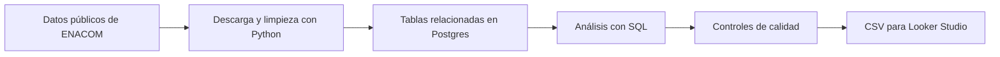

# Radiografía de las telecomunicaciones en Argentina

**Proyecto de portfolio de análisis de datos y BI con Python, SQL y datos públicos de ENACOM.**

¿Cómo evolucionó Internet fijo en Argentina? ¿Qué diferencias hay entre provincias? Este proyecto transforma publicaciones oficiales en información comparable sobre cantidad de conexiones, participación de fibra óptica y velocidad de descarga.

El foco está en recorrer un trabajo habitual de análisis: obtener datos, organizarlos, comprobar su calidad y preparar indicadores que una persona no técnica pueda interpretar.

## El problema que aborda

Para comparar mercados provinciales, primero hay que reunir información de distintas fuentes, trabajar con los mismos períodos y evitar errores al sumar o cruzar datos.

El proyecto responde tres preguntas:

- **Tamaño y tecnología:** ¿cuántas conexiones hay y qué proporción corresponde a fibra?
- **Evolución:** ¿cuánto cambió la cantidad de conexiones frente al mismo trimestre del año anterior?
- **Comparación provincial:** ¿qué lugar ocupa cada jurisdicción por velocidad y cantidad de conexiones?

Estas preguntas son pertinentes para explorar el mercado de telecomunicaciones y plantear análisis comerciales posteriores. Las fuentes son agregadas: no permiten evaluar clientes ni el desempeño particular de un operador.

## Resultados principales

Datos correspondientes al **segundo trimestre de 2026**, según la descarga verificada el **19 de octubre de 2026**.

| Indicador | Resultado |
|---|---:|
| Accesos de Internet fijo, suma de las jurisdicciones | **13.768.437** |
| Accesos de fibra óptica | **6.900.971** |
| Participación de fibra sobre el total | **50,12%** |
| Crecimiento de accesos frente a 2025-T2 | **12,36%** |
| Velocidad de descarga, promedio simple de las 24 jurisdicciones | **187,79 Mbps** |

Buenos Aires registra **5.699.031 accesos** y un crecimiento interanual del **6,32%**. CABA ocupa el primer puesto de velocidad publicada, con **372,42 Mbps**, y el segundo por cantidad de accesos. Esto muestra por qué tamaño del mercado y velocidad deben analizarse por separado.

Los resultados se calculan desde las consultas del proyecto. Se pueden revisar en los [CSV exportados](exports/) y en el [resumen de hallazgos](reportes/hallazgos.json).

## Cómo funciona



Se conservan los archivos originales y se registran las transformaciones para poder rastrear de dónde sale cada cifra. El historial cubre **2014-T1 a 2026-T2**, con **24 jurisdicciones y 50 trimestres**.

## Qué incluye y qué permite demostrar

| Parte del proyecto | Trabajo realizado |
|---|---|
| Obtención y preparación | Descarga de tablas oficiales y consumo de una API; conversión de formatos numéricos y encabezados |
| Base relacional | Seis tablas en PostgreSQL/Supabase, con claves para evitar duplicados y referencias inexistentes |
| Análisis SQL | Tres consultas guardadas: cruces y resultados intermedios con JOIN y CTE, crecimiento con LAG y rankings con RANK |
| Calidad | 40 controles sobre valores, duplicados, relaciones y coincidencia entre los archivos y la base |
| Performance | Comparación del plan y tiempo de una consulta antes y después de crear un índice |
| Preparación para BI | Exportación de resultados agregados y guía de una página con indicadores y filtros |

**Herramientas:** Python 3.12+, biblioteca estándar de Python, PostgreSQL, Supabase y SQL. La preparación para Looker Studio se entrega mediante CSV y una guía de armado.

## Decisiones que cuidan la confiabilidad

- **Conservar el origen:** los archivos descargados se mantienen sin alterar sus cifras.
- **Sumar antes de cruzar:** las tecnologías se agrupan por provincia y trimestre antes de unirlas con velocidades; así se evita multiplicar valores.
- **Distinguir cero de faltante:** se conservaron 61 cantidades cero. Los primeros 96 resultados de crecimiento quedan sin valor porque falta el año previo para comparar.
- **Contrastar la carga:** se comparan claves y valores de los CSV contra la base, además de contar filas.
- **Calcular porcentajes desde sus componentes:** el porcentaje agregado de fibra se obtiene dividiendo la suma de fibra por la suma de accesos, sin promediar porcentajes provinciales.

La ejecución verificada terminó con **40 controles sin incidencias detectadas y nueve pruebas aprobadas**. Eso demuestra consistencia con las reglas revisadas; no garantiza que las declaraciones originales sean completas.

## Medición de performance

En una tabla de **6.000 filas**, la mediana de ejecución de la consulta medida pasó de **1,032 ms a 0,528 ms** tras crear un índice alineado con el filtro. Se tomaron tres mediciones por etapa y se comprobó el cambio de plan de ejecución.

La diferencia fue de **0,504 ms**: pequeña en tiempo absoluto. No se presenta como evidencia de rendimiento a gran escala. Los [planes y tiempos](reportes/planes_performance.json) y su [explicación](docs/06_performance.md) quedan disponibles para revisión.

## Explorar el proyecto

No hace falta configurar una base para revisar los entregables:

- [Datos preparados para el tablero](exports/tablero.csv).
- [Consultas SQL](sql/02_vistas.sql) y [explicación con ejemplos reales](docs/05_sql.md).
- [Reporte de calidad](reportes/reporte_calidad.csv).
- [Modelo de tablas y decisiones](docs/04_base.md).
- [Guía de seis pasos para Looker Studio](GUIA_TABLERO.md).

## Tablero

Enlace: [Ver tablero interactivo en Looker Studio](https://datastudio.google.com/reporting/459b62fa-8c6f-4ebd-b4bd-b16a72181dfa/page/ppbBG)

Está hecho en Looker Studio (Data Studio), lee `exports/tablero.csv` a través de una hoja de Google Sheets con `IMPORTDATA` y abre en el trimestre **2026-T2**.

La captura del tablero irá en `docs/tablero.png`.


La carpeta [`exports/`](exports/) permite ver los resultados sin tener un proyecto
propio de Supabase. Incluye los CSV de las tres vistas y `tablero.csv`, que las reúne
por provincia y trimestre.

## Fuentes y alcance

Productor: **ENACOM, Ente Nacional de Comunicaciones**.

- [Accesos por tecnología y provincia](https://indicadores.enacom.gob.ar/DatosAbiertos/Internet/accesos-tecnologias-provincias).
- [Velocidad media de descarga por provincia](https://indicadores.enacom.gob.ar/DatosAbiertos/Internet/velocidad-media-provincias).
- [API de velocidad provincial del último período](https://indicadores.enacom.gob.ar/DatosAbiertos.asmx/InternetVMDProvinciasUltimoPeriodo).

La API provincial entrega solo el último trimestre. El historial se extrae de las tablas HTML oficiales y Python genera los CSV: no se logró verificar una descarga CSV directa. El detalle está documentado en [FUENTES.md](FUENTES.md).

Los accesos **no equivalen a personas ni hogares únicos**. Las velocidades son indicadores publicados, no mediciones propias de experiencia de usuario. No se usan datos personales ni información interna de empresas. Es un proyecto educativo de portfolio, sin afiliación con ENACOM ni con operadores.

## Reproducir el trabajo

### Prueba local sin credenciales

Se requiere Python 3.12+ disponible como `python` en la terminal. Los programas utilizan la biblioteca estándar de Python, sin paquetes adicionales. Cloná el repositorio y entrá a su carpeta:

```powershell
git clone https://github.com/Perree/radiografia-telecom-argentina.git
cd radiografia-telecom-argentina
```

Ejecutá estos comandos en orden, sin crear `.env` ni configurar Supabase:

```powershell
python --version
python -m unittest discover -s tests -v
python src/ingesta.py --desde evidencia
python src/carga.py
python src/medir.py --solo-resumir
```

El repositorio contiene 15 tests: en un clon limpio pasan 11 y se omiten cuatro que necesitan una captura de la base. Las nueve pruebas originales están incluidas; una prueba omitida no cuenta como aprobada. La ingesta transforma los originales públicos incluidos en `evidencia/`; la carga solo genera SQL, sin ejecutarlo; la medición solo resume los planes históricos, sin medir otra vez.

Los resultados de `exports/` ya están versionados y pueden abrirse sin credenciales. Las capturas de `data/` no están en Git: por eso el pipeline completo `--sin-red`, los controles `--desde-captura` y la regeneración de exports `--desde-captura` no funcionan en un clon limpio sin obtener antes esas capturas. Esta prueba local no los ejecuta ni genera resultados ficticios.

### Flujo conectado: detenerse aquí si no hay un proyecto y credencial propios

Para la ejecución conectada se necesita un proyecto propio de Supabase. Copiá `.env.example` a `.env`, reemplazá `tu_project_ref_aqui` por la referencia de ese proyecto y asegurate de que coincida con `supabase_project_ref` en `proyecto.json`. Configurá `SUPABASE_ACCESS_TOKEN` con una credencial de administración propia; no es la clave pública de la API de datos. También se pueden usar variables de entorno en lugar de `.env`.

El siguiente comando descarga datos, crea o carga las tablas, prepara las vistas, mide el índice, controla calidad y exporta. **Escribe en la base**; no se ejecutó durante esta revisión. Si no disponés de configuración propia, frená antes de este paso:

```powershell
python src/pipeline.py
```

Las credenciales se configuran mediante variables de entorno o un `.env` excluido del repositorio; [.env.example](.env.example) muestra los campos necesarios.

La [guía de ejecución](docs/EJECUCION.md) amplía el detalle de cada etapa.

**Validación realizada:** descarga y procesamiento con Python, carga y consultas reales mediante el conector de Supabase, controles y exportaciones. La reproducción local con capturas fue verificada. La autenticación HTTP mediante token personal todavía no se probó; esa limitación está detallada en la guía.

## Estructura del repositorio

| Carpeta | Contenido |
|---|---|
| `src/` | Programas de descarga, carga, controles, medición y exportación |
| `sql/` | Esquema, vistas, consulta medida e índice |
| `tests/` | Pruebas de transformación y detección de errores |
| `exports/` | Resultados agregados para revisar o usar en BI |
| `reportes/` | Evidencia de calidad, performance y resultados |
| `docs/` | Explicaciones y guía de ejecución |
| `evidencia/` | Copia inicial de respuestas públicas para inspección |

El [glosario](GLOSARIO.md) define los términos utilizados.

## Próximas mejoras

Validar el tablero, verificar la ejecución conectada mediante token personal, incorporar indicadores de penetración con sus cambios metodológicos y automatizar actualizaciones con alertas de calidad.

El proyecto se construyó como práctica guiada. La evaluación de comprensión está pendiente; las afirmaciones personales para el CV se definirán después de completarla.

Licencia: MIT
