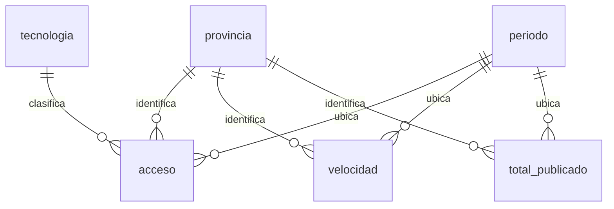

# Paso 4: base y esquema relacional

## a) Qué hacemos y por qué

Guardamos los datos en Postgres, dentro del proyecto nuevo y gratuito de Supabase
`radiografia-telecom-argentina`. Las mediciones se vinculan a referencias comunes
para evitar escribir nombres de provincias o tecnologías de maneras diferentes.

## b) Qué hicimos

Proyecto autorizado: `onsfufyujspxuhbqoxhd`, región São Paulo, Postgres 17.11.
Costo cotizado al crearlo: USD 0 por mes. No accedimos a otras bases.

| Tabla | Qué representa una fila | Filas verificadas |
|---|---|---:|
| provincia | Una provincia o CABA | 24 |
| periodo | Un año y trimestre | 50 |
| tecnologia | Una categoría de tecnología publicada | 5 |
| acceso | Accesos de una provincia, período y tecnología | 6.000 |
| velocidad | Velocidad de una provincia y período | 1.200 |
| total_publicado | Total de accesos informado por ENACOM para provincia y período | 1.200 |

## c) Qué hace el SQL

Archivo: `sql/01_esquema.sql`, con comentarios junto a las definiciones.

| Instrucción nueva | Cómo leerla |
|---|---|
| `CREATE SCHEMA IF NOT EXISTS telecom` | Crea una carpeta lógica si todavía no existe. |
| `CREATE TABLE IF NOT EXISTS ...` | Crea la tabla y sus reglas sin borrar datos previos. No actualiza por sí sola una estructura antigua. |
| `provincia_id bigint GENERATED ALWAYS AS IDENTITY PRIMARY KEY` | Crea un número único administrado por Postgres para cada provincia. No es un código geográfico oficial. |
| `nombre text NOT NULL UNIQUE` | Guarda texto, obliga a informarlo e impide nombres repetidos. |
| `anio smallint` y `trimestre smallint` | Guardan enteros pequeños. |
| `CHECK (...)` | Rechaza valores que incumplen una condición, como trimestre 5 o cantidad negativa. |
| `PRIMARY KEY (anio,trimestre)` | La combinación completa identifica un período. Año solo no alcanza. |
| `REFERENCES telecom.provincia(provincia_id)` | Exige que la provincia ya exista en su tabla. Es una clave foránea. |
| `FOREIGN KEY (anio,trimestre) REFERENCES ...` | Comprueba la relación entre el par año/trimestre y la tabla de períodos. |
| `cantidad bigint` | Guarda una cantidad entera de accesos, incluidos los ceros. |
| `mbps numeric` | Guarda un número decimal exacto sin imponer redondeo al cargar. |
| `REVOKE ...` | Retira permisos de acceso a los roles web indicados. |
| `ENABLE ROW LEVEL SECURITY` | Activa controles por fila. Aquí no damos permisos de lectura web: las consultas son administrativas. |

Normalizar significa separar hechos que dependen de cosas distintas. El nombre
de Córdoba depende de su identificador; sus accesos dependen además del período
y de la tecnología. Por eso viven en tablas distintas.

Guardamos el total publicado aparte aunque se pueda sumar: es un dato original
útil para contrastar la suma, no un total que recalculamos y hacemos pasar por la fuente.
La velocidad de la API ya existe en el historial y no se vuelve a insertar como otra medición.

### La carga, línea por línea de su patrón

`src/carga.py` genera los valores desde los CSV reales y crea sentencias con esta estructura:

| Línea del patrón | Qué hace |
|---|---|
| `WITH entrada(...) AS (VALUES ...)` | Nombra las filas que llegan del CSV. No crea observaciones nuevas. |
| `INSERT INTO telecom.acceso(...)` | Indica qué columnas vamos a cargar. |
| `SELECT p.provincia_id,e.anio,e.trimestre,...` | Toma las mediciones y el identificador correspondiente de provincia. |
| `FROM entrada e JOIN telecom.provincia p` | Relaciona la entrada con las provincias registradas. |
| `ON p.nombre=e.provincia` | Define la coincidencia por nombre exacto. La limpieza previa limita los nombres admitidos. |
| `ON CONFLICT (...) DO UPDATE SET ...` | Si la misma clave ya existe, actualiza la cifra en lugar de duplicarla. |
| `BEGIN` y `COMMIT` | Agrupan toda la carga en una transacción. Si falla una sentencia, la carga no queda a medias. |

La carga actual actualiza o agrega claves. Si ENACOM retirara una observación,
no la borra automáticamente: el control CSV contra base lo detectaría.

El asesor de Supabase devolvió seis avisos informativos por RLS sin políticas.
Es deliberado para este proyecto privado: no hay acceso web concedido ni se expuso
el esquema `telecom`. [Explicación oficial del aviso](https://supabase.com/docs/guides/database/database-linter?lint=0008_rls_enabled_no_policy).

## d) Analogía

Una agenda guarda el nombre del contacto una sola vez. Cada pedido apunta a ese
contacto. Así no terminás con “Córdoba”, “Cordoba” y “Cba” como si fueran tres provincias.

## e) En una entrevista

“Diseñé tablas de referencia y mediciones con claves primarias y foráneas.
La carga se ejecuta en una transacción y actualiza claves existentes sin duplicarlas.”
